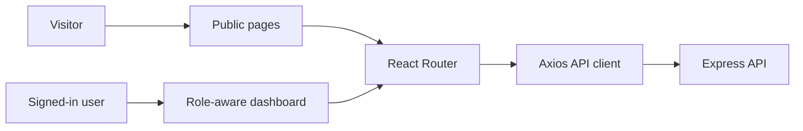

# Nexa CRM — Frontend


> **I built Nexa CRM to make the work behind a service business easier to follow:** customers, services, orders, projects, and the people delivering them, all connected through one clear interface.

The frontend combines a public website with a role-aware CRM dashboard. Visitors can explore the service catalog before signing in; authenticated users can work with the parts of the business their role allows.

## What I built

- **Public website:** a landing page, live service catalog, and individual service pages backed by the API.
- **Service requests:** visitors can choose a service and continue to sign-in without losing their selection.
- **Role-aware workspace:** dashboard views for administrators, employees, and clients.
- **Business workflows:** client and employee records, service management, orders, project tracking, and dashboard summaries.
- **Thoughtful UI details:** responsive layouts, dark mode, loading and error states, keyboard focus styling, and reusable form and navigation components.

## How the app is organized



### Main routes

| Route | Purpose |
| --- | --- |
| `/` | Public landing page and featured services |
| `/services` | Browse active services |
| `/services/:id` | View a service and begin a request |
| `/login`, `/register` | Sign in or create a standard client account |
| `/dashboard` | CRM overview |
| `/dashboard/services` | Manage and browse services |
| `/service-details/:id` | View a service from the dashboard |
| `/clients`, `/employees`, `/orders`, `/projects` | Role-protected CRM workflows |

## Stack

- React 19, TypeScript, and Vite
- React Router 7
- Tailwind CSS 4
- Axios for API requests
- ApexCharts and FullCalendar for dashboard visualizations and scheduling

## Run locally

Use Node.js and npm. Start the backend and configure its database first; then, from this directory:

```bash
npm install
```

Create `frontend/.env.local` if the API is not running at the default address:

```env
VITE_API_URL=http://localhost:5000
```

Start the development server:

```bash
npm run dev
```

Vite prints the local URL when it starts.

## Useful commands

```bash
npm run lint       # Check frontend code with ESLint
npm run build      # Type-check and create a production build
npm run preview    # Preview the production build locally
```

## Project structure

```text
src/
├── api/            # Axios configuration and auth handling
├── components/     # Shared UI, forms, charts, and dashboard widgets
├── context/        # Authentication, theme, and sidebar state
├── layout/         # Public and authenticated app shells
├── pages/          # Public pages, auth pages, and CRM screens
├── services/       # Typed API calls
└── utils/          # Order form and draft helpers
```

## A note from me

I care about building software that is understandable as well as useful. In this project, I focused on keeping the public experience approachable while giving the internal team a practical, role-based workspace. The frontend is designed to grow alongside the API rather than hide the business rules in presentation code.

## Find me

- **GitHub:** [himaalshame](https://github.com/himaalshame)
- **LinkedIn:** [Ibrahim Ilshamy](https://www.linkedin.com/in/ibrahim-ilshamy/)
- **Portfolio:** [himaalshame.github.io/my-Protfolio](https://himaalshame.github.io/my-Protfolio/)
- **WhatsApp:** [Message me](https://wa.me/+201020679141)
